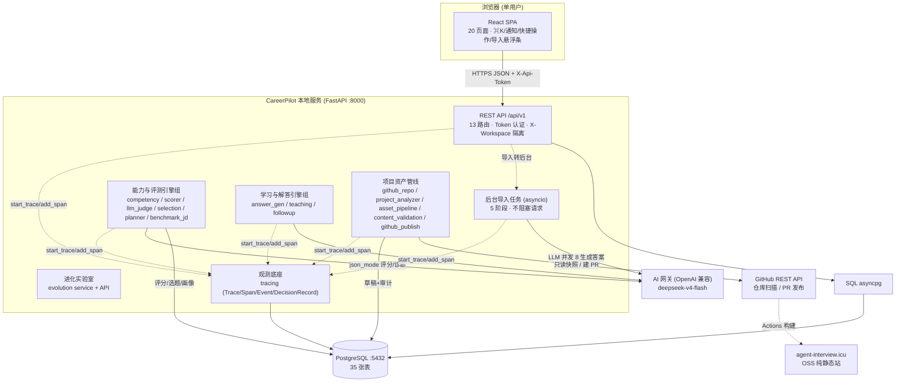

# CareerPilot 架构与模块说明

> **2026-11-17 后续实测：** 用户新答案在隔离库真实评分完成，原答→冻结标准→Evidence→对应学习任务/目标和画像重算走通；原课程完成与长期保持未被推断。补充修复评分状态/部分正确展示和安全HTTP阶段诊断，后端446、前端149项通过。Project Autopilot本次任务预算已授权500，但当前累计11次调用后因重复响应头等待超时暂缓，134个检查点保存，完整报告仍未生成。当前入口见 [docs/ai-reports/01-assessment/README.md](docs/ai-reports/01-assessment/README.md)；下方预算暂停及旧测试数为此前历史。

> **2026-11-17 学习反馈更新：** 在既有学习任务下新增目标、活动、提交版本和项目快照关系；练习复用独立评分 Worker 的 `PRACTICE` 模式，反馈不生成个人能力 Evidence。提示/参考曝光、源码引用、候选记忆确认、来源撤回与局部计划调整已接入；项目结果只做代码检查，不代表执行通过或个人理解。最终本轮后端441项、前端137项通过，真实模型仅完成一次明确标记的历史原答反馈重放。新用户修订/独立复测、真实项目实践和长期效果尚未验收；Project Autopilot 原预算阻塞仍保留。当前验收入口见 [docs/ai-reports/02-learning-loop/README.md](docs/ai-reports/02-learning-loop/README.md)。下方395/114等数字属于前序验收记录。

> **2026-11-17 更新说明：** 下文保留旧提交的架构快照，不能作为当前功能已启用或已验收的证明。当前公共发布与策略自动激活关闭；题目入库、项目代码或学习完成不会直接产生个人掌握证据。项目的数字能力矩阵已移除，结构扫描仅展示覆盖信息。
>
> 当前项目链路：导入仓库 → 独立 Worker 后台读取固定提交 → PostgreSQL 阶段检查点（`project_analyses` / `project_analysis_steps`）→ 完整报告 → 待确认项目记忆（`memory_items`）→ 用户确认后才进入补题上下文（`question_generations`）→ 审核题目 → 实际作答评分（`exams.project_assessment` 保存项目来源）→ 个人表现证据与失分学习任务。定时版本检查和增量分析也在 Worker 中，浏览器与 API 不承担长任务。源码结论与个人能力分别记录。
>
> **本次评分更新：** 开考冻结题目/Rubric/岗位目标，答案追加revision；提交原子保存后202返回任务。同一独立Worker按题处理`assessment_scoring_runs/steps`，模型不持数据库长事务，严格校验原答引用/逐项档位并确定性计算总分，全部有效后原子发布报告、Evidence、画像快照与学习任务。非空开放题失败不作规则降级；未校准高分只是表现观察，个人估计的confidence仅是覆盖启发式。最新实测为后端395/前端114通过、真实旧答影子评分与教学成功；完整项目模型报告及真人新题复测仍有阻塞。个人库未部署本轮修改。以 [docs/ai-reports/01-assessment/README.md](docs/ai-reports/01-assessment/README.md) 为当前验收入口。
>
> 本轮变更、验证范围与使用步骤见 [docs/ai-reports/03-project-autopilot/README.md](docs/ai-reports/03-project-autopilot/README.md)。旧版自动记忆、能力计分或自动发布描述与当前代码冲突时，以本轮更新报告和代码为准。

> 供代码审计使用。本文与代码同步于 commit `52309390fe02c6780fdd7a6ee7022a0ffafb0688`（master）。
> 可视化架构图：`.archify/architecture-careerpilot-*/careerpilot-architecture.html`（archify 渲染，证据标注版）。

CareerPilot 是一个 **local-first（本地优先）的 AI 工程师求职进阶平台**：面经导入 → 能力画像 → 考试评测 → 学习规划 → 项目与职业资产自动发布。单用户/单工作空间本地部署，PostgreSQL 存储，LLM 只承担语义任务（生成/评分/教学内容），一切业务判定（评分 verdict、能力状态、发布风险、进化样本阈值）均为**确定性代码**。

- 后端：FastAPI + SQLAlchemy(async) + asyncpg + PostgreSQL，13 个路由模块 / 19 个服务模块 / 35 张表，约 9,600 行
- 前端：Vite + React 18 + react-router，20 个页面组件 + 6 个全局组件，约 6,900 行
- 公开门户：`portal/` 静态站生成器（agent-interview.icu，纯静态，与私人数据物理隔离）

---

## 1. 系统总览



主链路（用户旅程）：**导入面经 → 审核 → 题库+证据 → 能力画像重算 → 学习任务规划 → 考试评测 → 差距收敛 → 项目扫描 → 职业资产发布到公开站**。观测底座横切所有写操作。

## 2. 运行拓扑与部署

| 形态 | 说明 |
|---|---|
| Docker Compose（推荐） | 三容器：`postgres:16-alpine` + `server`（uvicorn:8000，启动时自动 `migrate.py` → `app.seed`）+ `web`（多阶段构建 → nginx:80 托管静态 SPA）。端口可用 `PG_HOST_PORT/API_HOST_PORT/WEB_HOST_PORT` 参数化。见 `docker-compose.yml`、`server/Dockerfile`、`web/Dockerfile`、`LOCAL_DEPLOYMENT_GUIDE.md` |
| 本地裸跑 | venv → `python migrate.py` → `uvicorn app.main:app --port 8000`；前端 `npm run dev`（:5173）。首次先 `python -c "from app.bootstrap import *"` 或直接 uvicorn（lifespan 会 `create_all`） |
| 老库升级顺序 | **必须** `create_all`（补缺表）→ `migrate.py`（幂等补列，`server/migrations/001_backend_completion.sql`）→ `seed`（种子幂等跳过）。纯 migrate 在全新库会 `relation not found` |
| 公开门户 | `node portal/build.mjs` 生成 `portal/dist/`（10 篇文章 + 20 道公开题），发布到 OSS；内容仓库走 GitHub PR 流（见 §6.4） |

配置全部来自环境变量 / `.env`（`server/app/config.py`）：`DATABASE_URL`、`API_TOKEN`（默认 `cp-dev-token`，Bearer 或 `X-Api-Token`）、`LLM_PROVIDER/LLM_API_KEY/LLM_BASE_URL/LLM_MODEL`、`GITHUB_TOKEN`、`PORTAL_TARGET_REPO/PORTAL_BASE_BRANCH/PORTAL_CONTENT_DIR/PORTAL_AUTO_MERGE`。页面级配置（设置页保存到 `app_settings` 表）**优先于** env，10s TTL 缓存即时生效。

## 3. 数据模型（35 表，全部 workspace_id 隔离 + FK CASCADE）

| 域 | 表 | 说明 |
|---|---|---|
| 工作空间 | `users` `workspaces` `workspace_members` `app_settings` | 单用户多工作空间；`app_settings` 存页面级 LLM/GitHub 配置（JSONB） |
| 能力 | `skills` `skill_states` `competency_snapshots` `evidence` | 8 能力域种子权重（Agent架构18%/工具14%/Memory12%/RAG10%/Eval16%/后端12%/可靠性12%/部署6%）；SkillState 5 态 UNKNOWN≠0；snapshots 追加式历史 |
| 题库与导入 | `questions` `import_sessions` `import_items` | 161+ 题静态种子 + 用户私有题；题目去重用 `canonical_question_id`（原题 + variants） |
| 考试 | `exams` `exam_questions` `exam_answers` | `frozen_snapshot` 冻结答卷；`judge_version` 区分 rule-v1/judge-v1 |
| 学习 | `learning_tasks` | UNDERSTAND/PRACTICE/RETEST，1/3/7 复测链（retest_of/retest_round） |
| 记忆 | `memory_items` | 5 类（CareerGoal/Preference/KnowledgeGapSignal/ProjectDecision/Feedback），CANDIDATE→ACTIVE/SUPERSEDED/DISMISSED |
| 对标 | `jd_sources` `job_standards` `job_standard_targets` | JD 解析落库 → 克隆种子标准 → 仅上调目标等级；`unique(role,level,version)` |
| 项目资产 | `projects` `project_scans` `project_findings` `career_assets` `asset_update_runs` | GitHub 扫描发现（VERIFIED/HIGH/UNVERIFIED_CLAIM）→ 资产更新运行 |
| 发布 | `public_content_drafts` `public_content_sources` `content_publication_runs` `content_publication_rules` `content_release_audit` | 草稿 → 校验 → PR → 发布 → 回滚全链审计 |
| 进化 | `evolution_candidates` `evolution_runs` | 策略候选 PROPOSED→EVALUATED→ACTIVE/REJECTED/ROLLED_BACK |
| 观测 | `traces` `trace_spans` `decision_records` `events` | Trace(含 trigger) + Span(含 `llm:*` Agent Run: model/tokens/cost) + 决策记录 + append-only 事件 |

迁移工具：`server/migrate.py`（asyncpg 直连顺序执行 `migrations/*.sql`，重复执行零副作用，不做版本记账——刻意取舍，见 `KNOWN_ISSUES.md`）。

## 4. 后端模块详解（server/app/）

### 4.1 入口与基础设施

| 文件 | 职责与关键逻辑 |
|---|---|
| `main.py` | FastAPI 实例；lifespan 里 `Base.metadata.create_all`（开发自动建表）；CORS 放行 :5173；13 个 router 统一挂 `/api/v1`；`/healthz` 免认证 |
| `config.py` | pydantic-settings 全量配置；`sync_database_url` 属性给 asyncpg 直连用 |
| `db.py` | `create_async_engine(pool_pre_ping=True)` + `async_sessionmaker(expire_on_commit=False)` + `get_session()` 依赖 |
| `api/deps.py` | `require_auth`（Bearer/X-Api-Token 校验，失败 401）→ `get_workspace`（`X-Workspace` header slug，404 兜底）。**所有业务路由强制 workspace 过滤**，多表 FK CASCADE 保证删除隔离 |
| `seed.py` | 种子：8 技能+权重、JobStandard v1.1（种子假设，`is_seed=true`）、公共题库、演示工作空间；幂等（存在即跳过） |
| `services/tracing.py` | `start_trace(short_code 可选, trigger, trigger_ref)` / `add_span`（**同步函数**）/ `finish_trace`（duration 可自动推算）/ `emit_event`。所有非只读操作产生 Trace（如 `TR-S{exam_id}` 评分、`TR-PS{t}` 扫描） |

### 4.2 引擎组：能力与评测

| 文件 | 职责与关键逻辑 |
|---|---|
| `services/competency.py` | `recompute_skill_states`（:31）：estimated = clamp(2.5 基线 + Σ 证据 support × 等级权重{VERIFIED 1.0/HIGH 0.8/MEDIUM 0.5/LOW 0.3/UNVERIFIED_CLAIM 0.15})；confidence = min(1, 0.2 + 0.08×high + 0.04×rest)；5 态判定（UNKNOWN ≠ 0；<2 证据且 conf<0.4 → NEEDS_VALIDATION）。全量重算后写 `CompetencySnapshot`（追加式，trigger 标记来源：exam_completed/import_approved/…） |
| `services/scorer.py` | `score_question`（:62）统一入口：MCQ 确定性比对；开放题 = 关键词覆盖度 ratio → pts = max×ratio（**非假分**，无 LLM 时的诚实规则层）；`build_feedback` 产出命中/缺失要点 + 下一步 |
| `services/llm_judge.py` | `judge_open_answer`（:39）：开放题 LLM 评分官，严格 JSON（points/reasoning/hit/missing），**verdict 由 points/max 比例确定性判定**（≥0.8 CORRECT / ≥0.4 PARTIAL），不信任 LLM 自报；空作答短路 0 调用；坏 JSON/缺 reasoning → fail-closed 返回 None → `SCORING_FAILED`（**绝不给假分**），报告页可「重新评分」 |
| `services/followup.py` | `suggest_followups`（:53）：7 类 Gap 分类（Concept/Mechanism/Application/Boundary/Trade-off/Expression/Verification）确定性追问建议 ≤2 条，每条附 why |
| `services/selection.py` | `select_questions_for_exam`（:26）：信息增益选题（UNKNOWN=0 优先、每域均衡、selection_reason 可解释）；**先查 Evolution 生效策略**（`get_active_candidate("exam_selection")`），应用 `difficulty_bias`（桶内索引偏移）/`prefer_unknown`，reason 标注 `rule-v1+EVO-xxxx` |
| `services/benchmark_jd.py` | `parse_jd`（:37）：8 域关键词命中（≥6 强 +0.5 / ≥3 中 +0.25，上限 5.0 **永不下调**）→ `build_targets` 基于当前最新标准克隆并上调；JD 落 `jd_sources`，标准落 `job_standards`（version=jd-{id}） |
| `services/llm.py` | `AgentAdapter`：配置动态解析（`app_settings['llm']` 优先 → env 兜底，10s TTL）；`chat/chat_with`（OpenAI 兼容 /chat/completions，json_mode → response_format，timeout 可配）；`chat_with` 支持 trace+span_name → 自动写 `llm:{model}` Span（provider/model/tokens/耗时/成本估算 ¥2/M tokens）；**LLM 未配置或调用失败 → 调用方全部走规则降级路径，接口不报错只诚实标注来源** |

### 4.3 引擎组：学习与解答

| 文件 | 职责与关键逻辑 |
|---|---|
| `services/answer_gen.py` | 深度解答生成（655 行）。LLM 路径：深度教学 prompt → 严格 JSON（tldr/elevator 30秒电梯稿/analogy 类比/examiner 考官视角/steps 拆解/how_to_answer 回答脚本/pitfalls/followups[{q,a}] 追问带答案/terms 术语卡）→ `render_html`（:512）渲染 10 区块答案 HTML。规则路径：DOMAIN_FRAME 8 域框架（同样含电梯稿/脚本/追问带答案）。来源标记 llm=「AI 深度生成」/rule=「规则模板」，前端原样展示 |
| `services/teaching.py` | `build_teaching_content`（:151）：7 步通俗教学内容（类比/示例/原则/步骤/自验），LLM 90s 超时 → 字段校验 → 失败走规则模板 → 写回 `task.content` 缓存；`help_answer`：7 种学习求助（更简单/类比/例子/结合项目/伪代码/画图/还是不懂），结果缓存 `content.help_cache[mode]` |
| `services/text_extract.py` | `extract_many`（:199）：PDF(pypdf)/DOCX(python-docx)/MD/TXT 直读，JPG/PNG 走 RapidOCR 本地 OCR；多文件 ThreadPoolExecutor 并行（引擎共享 + 双检锁初始化）；**被调用方为后台任务线程池，不阻塞事件循环**（bank.py 以 `asyncio.to_thread` 调用） |

### 4.4 项目资产管线

| 文件 | 职责与关键逻辑 |
|---|---|
| `services/github_repo.py` | GitHub REST 只读快照：`collect_repo_snapshot`（:130）= meta+README(64K)+tree(截断标记)+languages+commits(Link 头翻页)；`fetch_file_text` ≤512KB；token 同 AppSetting 优先机制 |
| `services/project_analyzer.py` | `analyze_snapshot`（:69）：14 条路径规则映射 8 能力域发现 + 内容正则升级 VERIFIED + README 声明无文件证据 → UNVERIFIED_CLAIM（带 60 字引用）；能力矩阵确定性计分（VERIFIED 1.0/HIGH 0.6/UNVERIFIED 0.25） |
| `services/asset_pipeline.py` | `create_asset_update`（:113）：渲染项目能力证据页 Markdown → `content_validation.run_all` → 风险分级（FAIL→HIGH / WARN 或 UNVERIFIED≥3→MEDIUM / 否则 LOW）→ 与上一版 diff → 建 `PublicContentDraft`（kind=PROJECT_EVIDENCE, license=OWNED）+ `AssetUpdateRun` |
| `services/content_validation.py` | `run_all`（:119）四道校验：privacy_scan（邮箱/手机/身份证 + 9 私人标记词）+ fact_check（量化声明无引用 → WARN）+ license_check（RESTRICTED=error）+ markdown_lint；汇总 PASS/WARN/FAIL；**低风险闸门 = PASS 才允许自动发布** |
| `services/github_publish.py` | `GitHubPublisher`：真实 GitHub API（建分支/commit/PR），`dry_run` 原子操作只返回 plan；幂等键 `publish-draft-{id}-{fingerprint}`；`get_github_token()` 页面配置优先 |

### 4.5 进化实验室

| 文件 | 职责与关键逻辑 |
|---|---|
| `services/evolution.py` | `propose_candidate`（:90）：`collect_signals` 读真实数据（完成考试/平均得分率/复测完成率/任务完成率）→ 确定性规则：已有开放候选不重复造、<3 份样本诚实拒绝、avg<0.6 → 降难度候选、avg≥0.85 → 提难度、复测率<0.5 → 缩短复测间隔、否则「暂无候选」。`evaluate_candidate`（:262）：确定性投影指标（弱域命中率/覆盖域数），样本量 <5 → `INSUFFICIENT_EVIDENCE`，覆盖下降记 regression。状态机 PROPOSED→EVALUATED→ACTIVE/REJECTED/ROLLED_BACK，默认人工批准，可回滚 |

### 4.6 API 路由（server/app/api/v1/，13 个）

| 文件 | 端点要点 |
|---|---|
| `bank.py`（963 行，9+ 端点） | 题库列表/详情/PATCH 题目/合并重复；**导入**：POST /imports(/upload) 立即建 session 返回（`_process_import` :298 为 asyncio 后台任务，5 阶段=解析→提取→技能映射→去重→生成草稿，每阶段真实耗时写 `meta.progress`）；GET pending / {id}；审核 approve（单题 item_ids / 全量，剩余 DRAFT==0 才关 session）/ reject；重新生成答案（force=true）/ 题库补答 |
| `exams.py`（764 行） | 创建（selection 选题）/ 保存答案（自动暂存）/ 提交（状态机 SUBMITTED→TRANSCRIPT_CONFIRMED→FROZEN(冻结快照)→SCORING→COMPLETED；judge 失败→SCORING_FAILED+502）/ abort / 懒惰 EXPIRED / 报告（确定性 skill_breakdown+overall 诊断 + POST /report/deep LLM 逐题剖析带缓存与缺题补齐重试）/ rescore |
| `dashboard.py` | 总览聚合：证据覆盖/待验证/今日任务/待审核 + 加权差距 + 最重要缺口 |
| `profile.py` | 能力画像：域/技能/SkillState 明细 |
| `benchmark.py` | GET 标准（最新非种子优先，note 区分种子假设/JD 版）/ POST /jd（解析+上调+trace）/ GET /jds |
| `learning.py` | 任务列表（today/planned/retest）/ 详情 / start / complete / GET content / POST help / POST tasks（手动创建 + 复测任务） |
| `memory.py` | 提取（规则 MTYPE_RULES + LLM json_mode）→ CANDIDATE / confirm / correct（新条目+旧 SUPERSEDED+superseded_by）/ delete（DISMISSED） |
| `observatory.py` | 通俗摘要 + traces / trace 详情（spans）/ decisions / events / **agents**（聚合 `llm:%` Span 按 model 统计调用/错误/耗时/tokens/成本估算） |
| `settings.py` | overview（账号/工作空间/成员/计数/连接状态，密钥只回显掩码）/ PATCH account / PATCH workspace / export（全量 JSON 下载）/ DELETE workspace（需输入 slug 确认）/ LLM 与 GitHub 连接 GET/PUT/DELETE/test（test 为真实调用返回延迟与回复） |
| `public_content.py`（689 行，15 端点） | 草稿 CRUD / validate / approve / **publish**（`publish_draft` :348：dry-run 可选、幂等键、auto_merge 读规则、成功→PR_CREATED→BUILDING→PUBLISHED）/ rollback（保留上一可用版本）/ rules / audit / publications |
| `projects.py` | 项目 CRUD（repo_url 解析）/ scan（真实 GitHub 扫描，失败 → scan FAILED + 502）/ scans / findings |
| `career_assets.py` | 资产列表 / sync（门户仓库 content 目录 sha256 指纹）/ updates 聚合视图 / run（生成更新）/ approve（**auto_merge 仅 LOW 风险，HIGH 强制人工**）/ rollback |
| `evolution.py` | candidates GET/POST / evaluate / approve / reject / rollback（状态校验 409；commit 后 `await session.refresh` 防 MissingGreenlet） |

### 4.7 认证与隔离要点（审计重点）

- 单 token 认证（`cp-dev-token`）——local-first 单用户取舍，**不是多租户安全边界**；工作空间隔离由 `get_workspace` + 每查询 workspace_id 过滤 + FK CASCADE 实现
- 密钥（LLM/GitHub）存 `app_settings`，API 只回显 `****尾4位`；`.env` 不入库（.gitignore）
- 隐私红线：`personal/` 目录不入库；公开草稿必过 privacy_scan；私人数据（考试答卷/记忆/画像）与公开站物理隔离（公开站只消费显式发布的 Markdown 快照）

## 5. 前端模块详解（web/src/）

### 5.1 全局机制

| 文件 | 职责 |
|---|---|
| `api/client.ts` | `BASE`（:4，`VITE_API_BASE` 可覆盖）/ Token 头 / `api.get/post/patch/put/del/upload` / `ApiError(status, detail)` / 全量类型定义 |
| `components/AppState.tsx` | 全局上下文（工作空间/主题/DEMO 标志） |
| `components/ImportMonitor.tsx` + `lib/importTracker.ts` | **导入完全后台化**：全局单例跨页追踪，2s 轮询，sessionStorage 持久化（F5 不丢），15 分钟超时；右下角悬浮进度条（所有页面可见）→ 完成时 toast + `cp-import-finished` 事件 → 停留在面经库页时自动弹审核窗 |
| `components/Overlays.tsx` | ⌘K 全局搜索 / 通知中心 / 快捷操作面板（真实动作调用对应 API） |
| `components/Sidebar.tsx` / `Topbar.tsx` / `ui.tsx` | 导航（5 主区+3 高级）/ 面包屑+搜索 / Modal/Tabs/Toast 等基础件 |
| `styles/*.css` | 设计系统（tokens/base/components），深色主题，与 Figma 稿对齐 |

### 5.2 页面 ↔ 后端映射（API-first + 诚实降级）

| 页面 | 数据来源 | 关键交互 |
|---|---|---|
| `Dashboard.tsx` | GET /dashboard | hero 差距卡（8 段权重条）/ 今日任务 / 待审核入口 |
| `Profile.tsx` + `CompetencyTabs.tsx` | GET /profile, /benchmark | 能力画像 5 态徽章 / 岗位对标表 |
| `ExamCenter.tsx` + `ExamTabs.tsx` | GET /exams, /learning | 考试历史（ABORTED/EXPIRED/SCORING_FAILED 状态齐全）/ 面经库 tab |
| `Diagnosis.tsx` | POST /exams → answers → submit | 作答（自动保存/计时/**StrictMode 下先恢复进行中考试再新建**）/ 放弃考试 Modal |
| `DiagnosisReport.tsx` | GET /exams/{id}/report, POST .../deep | 确定性诊断 + 能力域得分条 + AI 深度诊断（缓存）+ judge-v1 徽章 + 追问建议 + SCORING_FAILED 重评按钮 |
| `Bank.tsx` | /bank/imports 系列 + bank.json | 导入（拖拽/粘贴/图片，提交即后台化）/ 审核窗（查看解答/重新生成/单题通过/全部通过）/ 编辑/合并/组卷 |
| `Learning.tsx` + `LearningTask.tsx` | /learning 系列 | 任务卡 / 7 步教学内容（AI 生成骨架+缓存）/ 7 种学习求助弹窗 |
| `Assets.tsx` / `ProjectReview.tsx` / `Pipeline.tsx` | /projects, /career-assets 系列 | 导入仓库（409 友好提示）/ 扫描发现（ev-chip 证据等级）/ 8 步资产流水线（dry-run/批准/回滚） |
| `Memory.tsx` | /memory 系列 | 候选记忆确认/纠正/删除 |
| `Observatory.tsx` | /observatory 系列 | 通俗摘要默认视图 + 高级 Trace/决策/Agent Run 开关 |
| `Evolution.tsx` | /evolution 系列 | 候选生成（样本不足诚实提示）/ 评估 / 批准 / 拒绝 / 回滚 |
| `Settings.tsx` | /settings 系列 + /public-content/rules | 5 tab 全可交互：账号编辑 / 工作空间 / LLM+GitHub 连接配置与真测 / 导出+删除 / 发布规则+审计日志 |
| `Benchmark.tsx` / `ProfileDetail.tsx` / `Onboarding.tsx` | /benchmark, /profile | JD 对标详情 / 技能详情 / 首次引导 |
| `data/bank.json` + `demo.ts` | 构建期由根题库生成 | **API 优先，后端不可用时降级为演示数据并挂 DEMO 横幅**（从不冒充真实数据） |

## 6. 五条核心流水线（端到端逻辑）

### 6.1 面经导入
```
上传(PDF/DOCX/MD/TXT/JPG/PNG/粘贴) → 立即返回 session(UPLOADED, step 0/5)
  → 后台 _process_import：解析(to_thread 并行 OCR) → 提取(LLM/规则, 置信度)
    → 技能映射 → 去重(原题+variants) → 答案草稿(LLM 并发 8, 重复题跳过)
  → REVIEW → 前端悬浮条完成通知 → 审核(approve 单题/全量, reject) → 入题库
  → 写证据(EV-I*) → recompute_skill_states → plan_tasks → CompetencySnapshot
```

### 6.2 考试评测
```
创建(selection 信息增益 + Evolution 生效策略) → 作答(自动暂存) → 提交
  → FROZEN(冻结快照) → SCORING(MCQ 确定性 / 开放题 LLM Judge, verdict 比例判定)
  → 全成: COMPLETED(score/verdicts/judges 计数) → 证据(EV-X*) → 画像重算 → 任务规划
  → 任一失败: SCORING_FAILED(无假分) → 报告页「重新评分」重试
报告 = 确定性(skill_breakdown/overall/priority) + LLM 深度诊断(缓存, 缺题自动补齐重试)
```

### 6.3 项目资产发布
```
导入仓库 → GitHub 快照(github_repo) → 规则分析(project_analyzer: 14 路径规则+内容确认+README 声明)
  → findings/能力矩阵 → 生成资产更新(asset_pipeline: Markdown+diff+风险分级)
  → 四道校验(content_validation: 隐私/事实/版权/lint)
  → approve(auto_merge 仅 LOW; HIGH 强制人工) → publish(幂等键, dry-run 可选)
  → GitHub PR(content/* 分支) → Actions 构建 → PUBLISHED(OSS 上线)
  → 失败: BUILD_FAILED(线上不动) / 回滚: rollback(上一可用版本)
```

### 6.4 进化闭环
```
collect_signals(真实 DB) → propose(确定性, <3 样本拒绝) → evaluate(投影指标, <5 样本=INSUFFICIENT_EVIDENCE)
  → 人工批准 → ACTIVE → selection.py 选题生效(reason 标注 EVO-xxxx) → 可回滚
```

### 6.5 观测
所有写操作 `start_trace` → 阶段 `add_span`（LLM 调用自动写 `llm:{model}` Agent Run Span）→ `finish_trace`；决策落 `decision_records`；事件 append-only。观测台默认「通俗摘要」，高级视图展开原始 Trace。

## 7. 状态机汇总

| 对象 | 状态流 |
|---|---|
| 导入 session | UPLOADED → PARSING → REVIEW → APPROVED；FAILED；item: DRAFT/APPROVED/REJECTED/MERGED |
| 考试 | CREATED → ACTIVE → SUBMITTED → TRANSCRIPT_CONFIRMED → FROZEN → SCORING → COMPLETED；SCORING_FAILED（可 rescore）/ ABORTED / EXPIRED（懒惰判定） |
| 发布 | DRAFT → VALIDATING → NEEDS_REVIEW → APPROVED → PR_CREATED → BUILDING → PUBLISHED；VALIDATION_FAILED / BUILD_FAILED / REJECTED / ROLLED_BACK |
| 进化候选 | PROPOSED → TESTING/EVALUATED → APPROVED → ACTIVE；REJECTED / ROLLED_BACK |
| 记忆 | CANDIDATE → ACTIVE → SUPERSEDED / DISMISSED |
| SkillState | UNKNOWN / NEEDS_VALIDATION / BELOW_TARGET / MEETS_TARGET / ABOVE_TARGET |

## 8. 已知边界与刻意取舍（详见 KNOWN_ISSUES.md）

1. 单 token 认证、无刷新轮询队列（asyncio 内存任务，重启丢进行中导入——session 会停在 PARSING，可重新导入）
2. 无 Alembic 版本迁移（`create_all` + 幂等 SQL）；无 Redis/消息队列（后台任务用 asyncio）
3. LLM 失败全链路降级为规则版并**诚实标注来源**（规则模板/规则评分），不冒充 AI 结果
4. Evolution 评估指标是确定性投影（非线上 A/B）；GitHub Actions 构建状态为记录字段（PENDING/RUNNING/SUCCESS/FAILURE），无 webhook 自动回写
5. 题库静态数据（161+ 题）构建期内联进前端 bundle（bank.json），私有题走 API

## 9. 审计建议入口（给 codex）

1. 端到端先读：`server/app/main.py` → `api/deps.py`（认证与隔离）→ `api/v1/bank.py:298`（后台导入）→ `api/v1/exams.py`（评分状态机）→ `services/competency.py:31`（画像算法）
2. 发布安全：`services/content_validation.py:119` + `api/v1/career_assets.py`（approve 的 auto_merge 闸门）+ `api/v1/public_content.py:348`
3. LLM 边界：`services/llm.py`（配置解析+Span）+ `services/llm_judge.py:39`（fail-closed）+ 各规则降级路径
4. 确定性纪律：`services/scorer.py:62` / `services/evolution.py:90` / `services/benchmark_jd.py:37`（永不下调）
5. 测试基线：`server/tests/test_engines.py`（19 用例）+ `docs/ai-reports/05-architecture/README.md`（8 场景）
