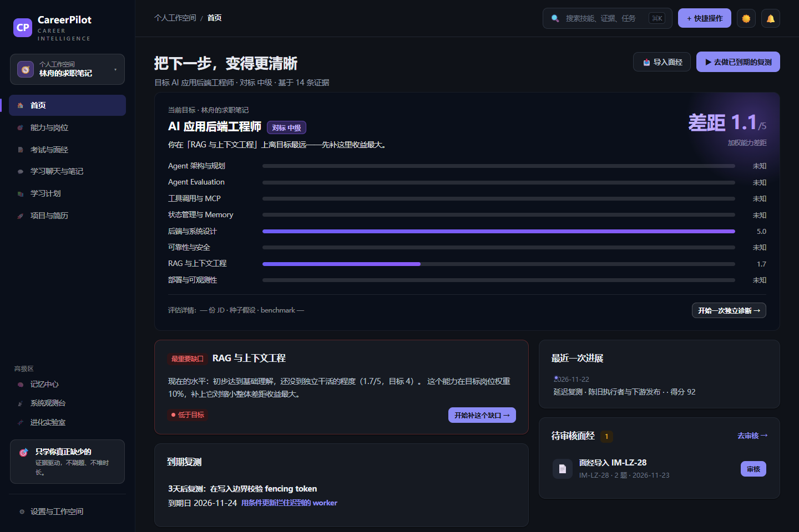

# CareerPilot

[简体中文](README.md) · **[Run locally (Chinese guide)](docs/getting-started.md)** · [Hosted service status](#cloud) · [Discussions](https://github.com/Lueyu/CareerPilot/discussions)

Practice for interviews with questions you have actually been asked and projects you have worked on. Answer a question on your own, review the points you missed, then work through the gap with an AI tutor. Come back to a different question to see whether you can explain the idea without a hint.



## A question to try

*Your import service receives the same file twice. How do you make sure it creates only one job?*

In the included workspace, Lin Zhou proposes a unique request key and describes how to write the job and its outgoing message in one transaction. The review points out that returning the existing job on every conflict would silently accept a different file sent with the same key. Open **Study this question** beside the question to discuss that case, then revisit it in the learning plan.

## Bring your own material

- Import interview notes as PDF, DOCX, Markdown or pasted text. Review draft questions before saving them to your private bank. [See the question bank](docs/images/questions.png)
- Use a study conversation to practice follow-up questions, save a note, or make review cards. Independent retests retain the original answer and its assessment. [Study and retest guide](docs/study-assistant.md)
- Record your role and decisions in a project, then select it as context when practicing. The included examples and skill dimensions focus on AI and backend engineering. You can bring your own questions for other roles.

<a id="cloud"></a>

## Get started

To start a fresh local workspace, install Git, Docker Compose and Python 3.12. In a dedicated Python environment, run:

```shell
git clone https://github.com/Lueyu/CareerPilot.git
cd CareerPilot
python -m pip install pydantic-settings sqlalchemy cryptography
python server/personal_credentials.py init --output personal/runtime/personal.env
docker compose --env-file personal/runtime/personal.env up -d --build postgres
docker compose --env-file personal/runtime/personal.env run --rm --no-deps server sh -c 'python personal_credentials.py check && python bootstrap.py && python migrate.py && python -m app.seed'
docker compose --env-file personal/runtime/personal.env run --rm --no-deps server python provision_recovery_control.py --confirm 'PROVISION KNOWN INSTALLATION careerpilot'
docker compose --env-file personal/runtime/personal.env up -d --build --wait
```

These commands are for a new volume only. Preserve existing personal environment files, roles, passwords and data. Register only a verified new/known installation; restored databases remain quarantined. Init creates random credentials once and never overwrites an existing file. Open [your local workspace](http://127.0.0.1:5173/), enter workspace personal and the API_TOKEN from your private environment file in WorkspaceLogin. Credentials are supplied at browser runtime, never through VITE_API_TOKEN. Choose English or 简体中文 in the language selector. Live AI conversations require a configured model provider. [Local setup guide](docs/getting-started.md)

Domain setup for the hosted service is in progress. Its launch address is [interview-buddy.com](https://interview-buddy.com/). In the meantime, you can run CareerPilot locally or ask about availability in [Discussions](https://github.com/Lueyu/CareerPilot/discussions/categories/q-a).

## Get involved

Bring an original interview question from your field, suggest another valid answer, or tell us where you got stuck. Discussions are public. Use examples you have permission to share and leave out personal details and company material. [Start a discussion](https://github.com/Lueyu/CareerPilot/discussions) · [Report a problem](https://github.com/Lueyu/CareerPilot/issues/new/choose) · [Contributor guide](CONTRIBUTING.md)

Original project code is available under the [MIT License](LICENSE). Third-party questions, articles and other materials retain their respective rights and licenses.
