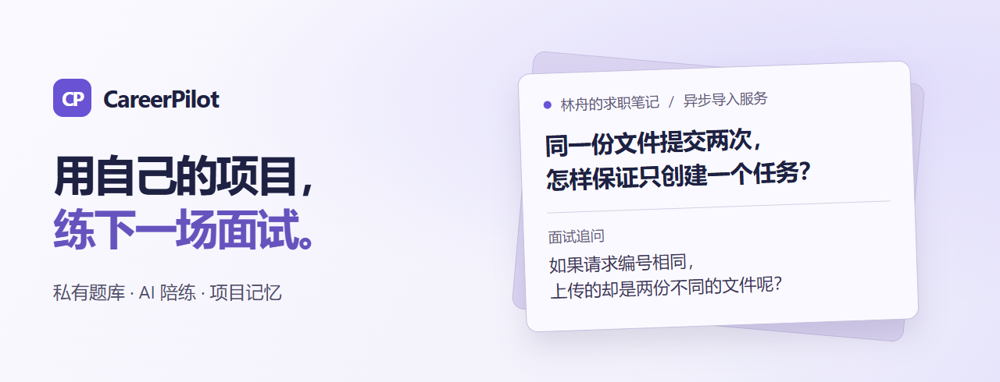
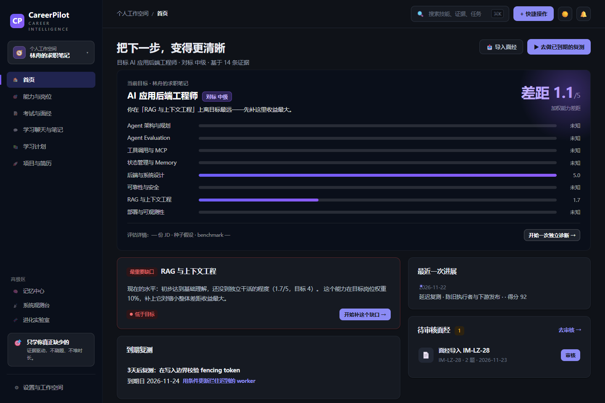

# CareerPilot

把自己的面经、目标岗位和项目经历放进同一个面试练习本。先独立答一题，再让 AI 面试官追问。答得含糊的地方可以带到学习助手里拆开讲，过几天换道题再试。

**[本机试用](docs/getting-started.md)** · [云服务开放进度](#cloud) · [参与讨论](https://github.com/Lueyu/CareerPilot/discussions) · [English](README.en.md)

## 先看一道题

> 异步导入服务收到了同一个文件的两次提交，如何保证重复请求只创建一个任务？

在「林舟的求职笔记」里，林舟答到了数据库唯一约束，也说清了任务和消息要一起写入。评阅抓住了原答里的一句「冲突就返回已有任务」。**如果两份文件用了同一个请求编号，直接返回旧任务会发生什么？**

在题目旁点 **围绕这个问题学习**，可以把这个边界条件带进对话，结合自己的实现追问。下次打开学习计划，还能看到「补齐同键异参的导入契约」这项任务。读过参考答案的练习保留学习记录，独立复测另存原答和评阅结果。

[打开题库截图，查看题目旁的练习和学习入口](docs/images/questions.png)

## 换成你的面试材料

| 手边有什么 | 在 CareerPilot 里可以做什么 |
| --- | --- |
| 一篇面经，或几道自己常被问住的题 | 在「考试与面经」导入 PDF、Word（.docx）、Markdown 或直接粘贴文本，审核后存进私有题库。也可以和学习助手聊出一道新题，再确认保存。 |
| 一份答得不满意的面试题 | 先答，再看评阅指出的遗漏。点「围绕这个问题学习」继续追问，把有用的片段整理成笔记和复习卡。 |
| 一个做过、却总讲不清的项目 | 在「项目与简历」记下你的职责、关键决策和验证结果。学习时选中项目，请助手根据已有资料追问你做了哪部分、怎样验证。 |

你可以带任何目标岗位的材料来练。仓库自带的题目和能力评估维度目前偏 AI 应用与后端工程，其他岗位可以从自己的题库开始。

## 选择使用方式

- **本机使用**　按指南启动个人工作空间，可以先看林舟的题库和已评阅答卷，再用自己的材料。AI 对话需要可用的模型配置。[第一次在本机运行](docs/getting-started.md)
- **云服务**　域名正在接入，目前可先在本机使用。开放后的访问地址为 [interview-buddy.com](https://interview-buddy.com/)。云端试用相关问题集中在 [Discussions 问答区](https://github.com/Lueyu/CareerPilot/discussions/categories/q-a)。

## 一起改进 CareerPilot

练习时遇到一道有歧义的公开题？写下另一种应当得分的答案和理由，就能帮到下一位练习者。想把它用到产品、运营或设计岗位，也欢迎带一道自己编的题和追问来交流。讨论区公开可见，请用原创或获准公开的材料，隐去个人和公司信息。

- [讨论练习方法或提岗位建议](https://github.com/Lueyu/CareerPilot/discussions) · [提交题目纠错或报告问题](https://github.com/Lueyu/CareerPilot/issues/new/choose)
- [第一次贡献](CONTRIBUTING.md) · [学习对话与复测](docs/study-assistant.md) · [Auto 如何选模型、检索资料与恢复中断](docs/auto-routing.md)

如果想在下次准备面试时找回这个项目，可以点 **Star** 收藏。想收到更新，在 **Watch → Custom** 选择感兴趣的通知。

## 许可证

CareerPilot 的原创程序代码采用 [MIT 许可证](LICENSE)。引用的第三方题目、文章和其他素材保留各自的权利和许可。
